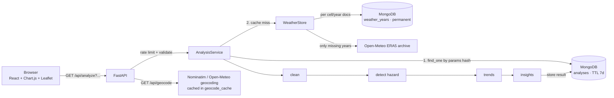

# Climate Hazard Trend Analyzer

Pick a place on Earth (a city, a state, or a lat/lon box you draw on a map), choose a period like 1990–2020, and see how **heatwaves** (or heavy-rainfall events) have changed there. You get statistically tested trends and a plain-English summary that says how confident you can be in it.

> Live app: https://climate-hazard-analyzer-chi.vercel.app · API docs: https://climate-hazard-api-mvr8.onrender.com/api/docs

  

---

## Contents
1. [What it does](#what-it-does)
2. [Quick start](#quick-start)
3. [Architecture](#architecture)
4. [Data source](#data-source)
5. [Hazard logic](#hazard-logic)
6. [Data handling (noisy real-world data)](#data-handling)
7. [Trend statistics and honest insights](#trend-statistics-and-honest-insights)
8. [Security and performance](#security-and-performance)
9. [API reference](#api-reference)
10. [Assumptions](#assumptions)
11. [What I'd improve with more time](#what-id-improve-with-more-time)
12. [AI tools used](#ai-tools-used)

More detail: [docs/ARCHITECTURE.md](docs/ARCHITECTURE.md) (design decisions and reasoning) · [docs/DEPLOYMENT.md](docs/DEPLOYMENT.md)

---

## What it does

**Frontend (React + TypeScript)**
- Region selection in three ways: **search** a city or state (states become boxes automatically), type a **point**, or draw a **lat/lon box** on a **Leaflet map** (bonus). The map then shows the actual ERA5 grid cells that were analysed.
- **Heatwave** is the default hazard. **Heavy rainfall** is a second hazard that uses the same pipeline.
- Time range from 1940 to the last complete year, with presets.
- Detection settings: percentile, minimum event length, threshold method (one threshold for the whole year, or one per calendar day), and baseline period.
- Visuals:
  - **Warming stripes** for the selected region (hero band).
  - An annual time-series bar chart with a 5-year rolling mean, Sen's slope trend line and an optional OLS line. A selector switches between 6–7 metrics.
  - An **event timeline** bubble chart (when in the year each event started, how long it lasted, how intense it was).
  - A table of the most severe events.
  - A **data quality** panel and a "Read with care" caveats panel.
- **Summary insight**, for example *"Heatwave days have increased by 29% in Bengaluru since 1990"*, always paired with the Mann-Kendall verdict ("…however, the long-term trend is not statistically significant").
- **PDF report and CSV export** (bonus): annual table and event list.
- Shareable URLs: every analysis is encoded in the query string.

**Backend (Python, FastAPI)**
- Ingests daily Tmax, Tmin and precipitation from **Open-Meteo's ERA5 archive**, cached per *(grid cell, year)* in **MongoDB**.
- Cleans the data (gaps, outliers, units, consistency) and reports every fix.
- Detects heatwaves (3+ consecutive days above the 95th percentile) and heavy-rain events.
- Computes trends with **Mann-Kendall + Sen's slope** (bonus), **linear regression** and rolling averages.
- Stores the finished analysis in MongoDB. API calls read from the database and return JSON summaries plus the trend-plot series.
- Rate limiting, strict input validation, safe upstream access (timeouts, retries, backoff, concurrency cap), CORS allow-list and security headers.

---

## Quick start

### Option A: no database, no Docker (fastest)
Requires Python 3.10+ and Node 18+.

**Backend**, from `backend/`:

```bash
# macOS / Linux / Git-Bash
python -m venv .venv && source .venv/bin/activate
pip install -r requirements-dev.txt
cp .env.example .env                 # MONGODB_URI=memory:// uses an in-process DB
uvicorn app.main:app --reload --port 8000
```

```powershell
# Windows PowerShell
python -m venv .venv; .\.venv\Scripts\Activate.ps1
pip install -r requirements-dev.txt
copy .env.example .env
uvicorn app.main:app --reload --port 8000
```

**Frontend**, from `frontend/` in a second terminal:

```bash
npm install
npm run dev        # http://localhost:5173  (proxies /api to :8000)
```

No internet? Set `DATA_SOURCE=synthetic` in `backend/.env`. The app then runs fully offline on deterministic fake data, and a banner in the UI says so.

### Option B: real MongoDB via Docker
```bash
docker compose up --build            # MongoDB + API on :8000
cd frontend && npm install && npm run dev
```

### Tests
```bash
cd backend && pytest -q              # 35 tests: cleaning, detection, statistics, API, security
cd frontend && npm run build         # strict TypeScript typecheck + production build
python backend/scripts/smoke_real_data.py   # one live end-to-end run against Open-Meteo
```

---

## Architecture



```
backend/app/
  main.py              app factory: middleware, error mapping, lifespan wiring
  config.py            every setting + its default, from env vars
  db.py                Mongo client (or in-memory mongomock) + TTL indexes
  regions.py           point/box -> snapped 0.25° ERA5 grid cells
  ratelimit.py         slowapi limiter with proxy-aware client IP
  routers/api.py       endpoints + pydantic query models (validation)
  hazards/             heatwave.py, heavy_rain.py, base.py (runs, percentiles), registry
  services/
    upstream.py        safe HTTP client: timeouts, retries, backoff, semaphore
    sources.py         Open-Meteo ERA5 source + synthetic offline source
    weather_store.py   read-through cache of raw daily data per (cell, year)
    cleaning.py        QC pipeline + quality report
    trends.py          Mann-Kendall, Sen's slope, OLS, rolling mean (hand-written)
    insights.py        honest plain-English summary + caveats
    analysis.py        orchestration + analysis cache + in-flight de-duplication
    export.py          CSV + PDF (ReportLab)
frontend/src/
  App.tsx              state, controls, layout, URL sync
  api.ts               typed API client (one query builder for analyze + exports)
  components/          RegionPicker, MapPicker, Stripes, Insights, TrendChart,
                       EventTimeline, TopEvents, DataQuality
```

Why each piece was chosen (FastAPI vs Flask, MongoDB document design, Chart.js vs D3, and so on) is in **[docs/ARCHITECTURE.md](docs/ARCHITECTURE.md)**.

---

## Data source

**ERA5 reanalysis** (ECMWF / Copernicus Climate Change Service) through the **[Open-Meteo Historical Weather API](https://open-meteo.com/en/docs/historical-weather-api)**.

| Why ERA5 via Open-Meteo | |
|---|---|
| Global, gap-free, consistent | Same method for every year 1940→present, so a trend is not an artefact of new stations appearing |
| Free, no API key | Easy for reviewers to run; no secrets to leak |
| Simple JSON over HTTPS | Copernicus CDS needs an account and async job queue + NetCDF/GRIB parsing |
| Multi-location requests | A 3×3 box is **one** HTTP call |

Variables: `temperature_2m_max`, `temperature_2m_min`, `precipitation_sum` (daily, GMT day boundary). I request `models=era5` explicitly. The default `best_match` blends datasets, and a switch of dataset partway through a series can create a fake step change that a trend test would report as real.

Geocoding uses **OpenStreetMap Nominatim** (it returns bounding boxes, so a state becomes a box), throttled to 1 request/second and cached per its usage policy. **Open-Meteo geocoding** is the fallback.

---

## Hazard logic

### Heatwave (default)
> A heatwave is **≥ 3 consecutive days** on which daily **Tmax is strictly above the 95th percentile** of daily Tmax for that region over the baseline period.

- **Relative threshold.** The same rule works for Bengaluru and Oslo: each place gets its own P95, which the UI shows next to the result.
- **Baseline.** By default this is the analysed period. You can pin it to 1961–1990 or 1991–2020. A fixed early baseline is the fairer comparison in a warming climate, because otherwise the threshold rises with the warming and absorbs part of the trend.
- **Two threshold methods.**
  - *Fixed* (default, what the brief describes): one percentile over all days. It captures dangerous absolute heat, so events fall in the hot season (April–May in Bengaluru).
  - *Calendar-day* (ETCCDI/WMO "warm spell" style): one percentile per calendar day with a ±7-day window. It catches spells that are unusually hot for the season, including winter warm spells.
- **Missing days never count as hot**, so a gap breaks a run. I never invent a heatwave by bridging a gap.
- An event belongs to the **year it starts in**.
- **Metrics per year:** heatwave days (primary), events, longest event, mean intensity (°C above threshold), cumulative heat (°C·days = frequency × intensity), hottest day, mean Tmax.

### Heavy rainfall
A wet day is ≥ 1 mm. The threshold is the **95th percentile of wet-day precipitation** (R95p-style), and a heavy-rain day is above it. Metrics: heavy-rain days, events, heavy-rain total (mm), wettest day (Rx1day), share of the annual total from heavy days, and annual total.

### Not implemented: drought
A credible drought index (SPI/SPEI) needs monthly aggregation, distribution fitting (gamma / log-logistic) and, for SPEI, evapotranspiration. A quick "days without rain" count would be misleading in monsoon climates where months-long dry seasons are normal. Following the brief's "scope over polish", I left it out instead of shipping something wrong. The hazard registry makes it a drop-in module: add one file in `backend/app/hazards/` and register it in `hazards/__init__.py`.

---

## Data handling

Real data is noisy, even reanalysis, and especially if you later swap in station data. The cleaning pipeline (`services/cleaning.py`) runs **per grid cell** before any averaging, and **every step is counted** in the quality report shown in the UI and PDF:

| Step | Rule | Why |
|---|---|---|
| Reindex | Full daily calendar; missing dates become explicit NaN | Silent missing rows would shorten years |
| Units | Verify the `daily_units` the API reports; convert °F/K→°C and inch→mm | Don't trust, verify |
| Physical bounds | Tmax ∈ [−90, 60] °C, precip ∈ [0, 1000] mm, else NaN | Impossible values |
| Rounding artefacts | −1 < precip < 0 → 0 | Common in gridded products; not a real error |
| Consistency | Tmax < Tmin − 0.5 → both NaN | One of them is wrong; we can't tell which |
| Spikes | Robust z (median/MAD vs calendar-day climatology) > 6 **and** a >10 °C jump from **both** neighbours | A real heatwave persists; a glitch jumps up and straight back down. Requiring both tests avoids deleting genuine record heat |
| Gaps | Linear interpolation for temperature gaps **≤ 2 days only**; longer gaps stay NaN; precipitation is never interpolated | Short gaps are safe to fill; long ones aren't, and rain isn't smooth |
| Coverage | A year with < 90% valid days is **excluded** from stats and trends | A missing summer would otherwise look like "fewer heatwaves" |
| Boxes | Daily area-mean of cleaned cells; a day needs ≥ half the cells present | One surviving cell can't pose as the regional mean |

**Caching:** raw data is stored **per (source, 0.25° cell, year)**. Nearby clicks snap to the same cell, and overlapping ranges only download missing years. For example, after 1990–2020, asking for 1980–2010 fetches only 1980–1989 (there's a test for this).

---

## Trend statistics and honest insights

`services/trends.py`. Mann-Kendall is hand-written so I can explain every line.

- **Mann-Kendall test** (two-sided, tie-corrected variance, continuity correction, α = 0.05). It is non-parametric, so it suits skewed count data with many zero years. This is the standard test in climate-extremes work, and the headline uses it.
- **Theil-Sen slope**: the median of all pairwise slopes, robust to outlier years. Shown as the dashed trend line.
- **OLS regression**: slope, R², p-value. Shown for comparison; it assumes normal residuals, which counts usually violate.
- **5-year centred rolling mean** to show the shape.
- **Lag-1 autocorrelation.** If it is > 0.3 the UI warns that the MK p-value may be optimistic.

**Rules for the summary sentence** (`services/insights.py`), designed so it can't overclaim:
1. Compare **decade averages** (first ~10 valid years vs last ~10), never first year vs last year.
2. Quote a **% change only if the baseline is ≥ 1 day/yr**. "0.1 → 0.5 days" is "+400%", which is technically true and misleading, so it shows the absolute change instead.
3. Every "increased/decreased" is paired with the **significance verdict**. If MK says not significant, the headline says so.
4. **Caveats are output, not fine print:** reanalysis vs stations, baseline effect, box averaging, autocorrelation, excluded years, small samples.

---

## Security and performance

| Concern | What's done |
|---|---|
| Rate limiting | Per-client limits (analyze 20/min, export 10/min, geocode 30/min, default 120/min) with `Retry-After`. Client IP comes from `X-Forwarded-For` **only at the configured proxy hop**, because the left side of that header can be spoofed |
| Input validation | Pydantic query models with `extra="forbid"` (typos → 422). Ranges for lat/lon/years/percentile; bbox regex + ordering + max 10° per side; minimum 10-year span; labels stripped of control chars and `<>` |
| Injection | No user input in Mongo queries (cache keys are SHA-256 hashes); upstream params passed as dicts (httpx encodes them); CSV cells starting with `= + - @` are prefixed with `'` (formula injection) |
| Upstream safety | Timeouts, 3 retries with exponential backoff + jitter, honours `Retry-After`, concurrency semaphore (2), response schema validation, no redirects, upstream error bodies never echoed to clients |
| HTTP hardening | CORS allow-list (GET only), `nosniff`, `X-Frame-Options: DENY`, CSP `default-src 'none'` on API responses, generic 500s (details only in server logs), non-root Docker user |
| Caching | 4 layers: browser/CDN (`Cache-Control`), finished analyses in Mongo (TTL 7 d), raw data per cell-year (permanent), geocoding (TTL 30 d). A repeat request is one indexed `find_one` |
| Stampede protection | Per-cell asyncio locks plus in-flight de-duplication, so 10 identical concurrent requests cause **one** upstream download |
| Efficiency | Multi-location upstream requests; 20-year chunks (partial progress persists); vectorised numpy/pandas; PDF rendering off the event loop; gzip; Vite code-splitting (map lazy-loaded) |
| Timeouts | Whole analysis bounded (120 s) with a helpful message; cached partial data makes the retry fast |

---

## API reference

Interactive docs: `/api/docs` (Swagger).

| Endpoint | Purpose |
|---|---|
| `GET /api/analyze` | Run (or fetch the cached) analysis |
| `GET /api/export/csv?…&table=annual\|events` | CSV export of the same analysis |
| `GET /api/export/pdf?…` | PDF report |
| `GET /api/geocode?q=Bengaluru` | Place search (points, plus boxes for states/regions) |
| `GET /api/meta` | Limits, available hazards, metric definitions |
| `GET /api/health` | Liveness + DB ping |

Common parameters: `hazard` (`heatwave` \| `heavy_rain`), `lat`+`lon` **or** `bbox=south,west,north,east`, `label`, `start_year`, `end_year`, `percentile` (80–99.9), `min_duration` (1–14), `threshold_method` (`fixed` \| `calendar`), `baseline_start`+`baseline_end`.

```bash
curl "http://localhost:8000/api/analyze?lat=12.97&lon=77.59&label=Bengaluru&start_year=1990&end_year=2020"
```

The response (abridged) has these keys: `meta`, `threshold`, `annual[]` (per-year metrics), `events[]`, `trends{metric: {mann_kendall, sens_slope, ols, lag1_autocorrelation, rolling_mean_5y}}`, `insights{headline, significance, confidence, decade_comparison, bullets, caveats}`, `quality{…}`, `stripes[]`.

---

## Assumptions

1. **ERA5 is "historical weather".** It is a physically consistent model-plus-observation reanalysis, not station data. It smooths local extremes such as urban heat islands and convective downpours, so absolute counts differ from station studies. Relative trends are robust.
2. **Only complete years** are analysed (latest = last calendar year), because a partial year would bias counts low.
3. **Days are GMT days** for every location, so all cells share one day boundary. Local-midnight days would shift Tmax by at most a few hours.
4. **Strictly above** the percentile, and **≥ 3 days**, as in the brief. Both are user-adjustable.
5. **A box is represented by its area-mean** over up to 3×3 sampled grid cells (≤ 10° per side). This is a regional-climate view; it dampens extremes compared with a single point.
6. **Events are attributed to their start year.**
7. **Minimum 10 years** of valid data, because MK on fewer points has almost no power.
8. **Boxes may not cross the antimeridian** (±180°).

---

## What I'd improve with more time

- **Statistics:** a modified Mann-Kendall (Hamed-Rao or pre-whitening) for autocorrelated series; bootstrap confidence intervals on Sen's slope; field significance for multi-cell boxes; return-period / GEV analysis for extreme intensity.
- **Hazards:** drought (SPI/SPEI from monthly precipitation and ET₀); humid heat (wet-bulb / heat index using humidity); compound hot-dry events.
- **Per-cell detection** for boxes ("% of area under heatwave"), and a **map heat layer** of trends per cell.
- **Data:** cross-check ERA5 against GHCN-Daily stations (NOAA NCEI) for points with a long station record; a "data source" selector.
- **Infra:** background jobs (Celery/RQ or Arq) with progress streaming (SSE) for long first downloads; Redis for shared rate limits and locks across instances; OpenTelemetry tracing; a circuit breaker on the upstream.
- **Frontend:** compare two regions or two periods side by side; dark mode; Playwright end-to-end tests; i18n.

---

## AI tools used

- **Claude (Anthropic), in a long agentic pair-programming session:** used to draft the backend modules, tests, React components and these docs from my requirements, to run the test suite and headless-browser screenshots in a sandbox, and to iterate on the UI.
- **What I did myself:** set the scope and architecture choices (FastAPI + MongoDB, ERA5 via Open-Meteo, MK + Sen as the headline statistic, "honest insight" rules), reviewed the modules, and checked the statistics against references (scipy's Kendall τ, a hand-worked MK example).
- **How I verified AI output:** 35 unit/API tests (planted heatwaves, gap-breaking, spike-vs-real-heat, cache-hit counting, rate limiting, injection), reading each file before committing, and manual runs of known places (for example, checking that Bengaluru's heatwaves cluster in April–May).
