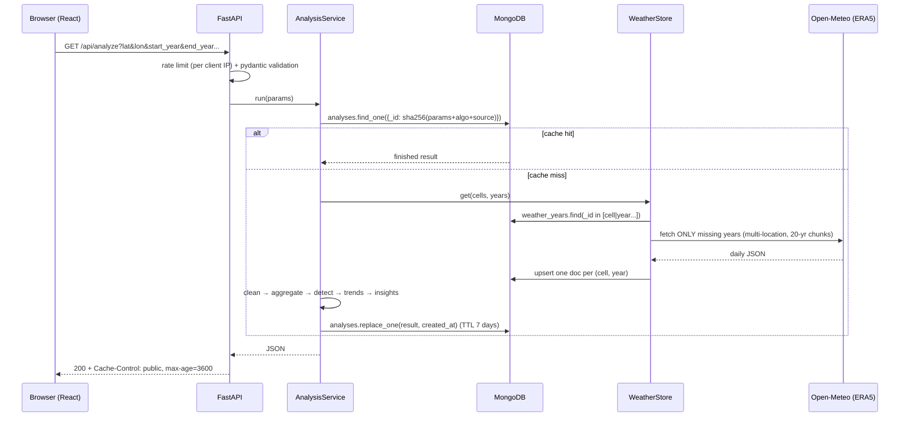

# Architecture and design decisions

This document explains **what** the system is and, more importantly, **why** each choice was made and what was traded away. Each decision follows the same pattern: *decision → reason → alternative considered → trade-off*.

---

## 1. System overview

The pipeline is a pure function of its inputs: **same parameters → same result**. That single property is what makes the aggressive caching safe, the URLs shareable, and the exports consistent with the screen.

---

## 2. Backend decisions

### 2.1 FastAPI (Python) as the framework
- **Why:** the brief requires a Python backend, and the domain work (percentiles, regression, Mann-Kendall) lives in numpy/pandas/scipy. FastAPI adds async I/O (the slow part is waiting on the upstream API), **pydantic validation** declared on the type (the security requirement for safe user input comes almost for free), and auto-generated OpenAPI docs at `/api/docs`.
- **Alternatives:** Flask (sync by default, validation by hand), Django REST Framework (heavy for 6 endpoints, and the ORM assumes SQL).
- **Trade-off:** async code must not block. CPU-heavy steps are short (≈50–200 ms of pandas), and PDF rendering, the heaviest, runs in `asyncio.to_thread`.

### 2.2 All endpoints are `GET` with query parameters
- **Why:** an analysis is a read of a deterministic function, so GET semantics are correct. GETs can be cached by browsers and CDNs (`Cache-Control: public, max-age=3600`), the URL *is* the shareable state, and export links are plain `<a href>`, so no blob handling is needed.
- **Alternative:** `POST /analyze` with a JSON body. It is more conventional for complex inputs, but you lose caching and shareability.
- **Guard:** one pydantic model (`AnalysisQuery`, `extra="forbid"`) is shared by `/analyze` and `/export/*`, so they can't drift apart and typos fail loudly.

### 2.3 MongoDB (the brief asks for NoSQL)
Three collections:

| Collection | `_id` | Content | Lifetime |
|---|---|---|---|
| `weather_years` | `open-meteo:era5\|12.75:77.50\|1995` | 3 arrays × 365 raw daily values + units | permanent (past reanalysis doesn't change) |
| `analyses` | SHA-256 of normalised params + algorithm version + source | finished JSON result | TTL index, 7 days |
| `geocode_cache` | normalised query | results list | TTL index, 30 days |

- **Why documents fit:** a year of daily arrays and a nested analysis result are both naturally *one document* that is read whole. A relational schema would mean ~11,000 rows per place per 30 years and a join to rebuild them.
- **Why per (cell, year) and not per request:** overlapping requests share work. 1990–2020 followed by 1980–2010 downloads only 1980–1989. Documents stay a few KB, far below the 16 MB limit. Past years are immutable, so no invalidation logic is needed.
- **Why store RAW and clean on read:** the original data stays auditable, and I can change QC rules (bump `ALGO_VERSION`) without re-downloading anything.
- **Why hash the parameters for the analysis key:** user input never reaches a query operator (no NoSQL injection), keys have a fixed size, and changing the algorithm version invalidates old results automatically.
- **TTL indexes** expire caches with no cron job.
- **Dev ergonomics:** `MONGODB_URI=memory://` swaps in `mongomock`, so the app and the tests need zero infrastructure. Production uses `pymongo`'s native `AsyncMongoClient`.
- **Alternatives:** Redis (great cache, poor as the system of record for growing data); DynamoDB or Firestore (fine, but vendor lock-in and harder local dev); PostgreSQL + JSONB (honestly would also work well, but the brief asks for NoSQL).

### 2.4 Data source: ERA5 via Open-Meteo
- **Why:** global, 1940→present, **temporally consistent** (one model for all years), free, no key, JSON over HTTPS, and multi-location requests.
- `models=era5` is pinned, because mixing datasets over time creates artificial trends.
- **Alternatives:** NOAA NCEI GHCN-Daily (real stations, but uneven coverage, station moves, and a gap-filling burden); Copernicus CDS (authoritative, but needs an account, an async job queue and NetCDF parsing, which is too slow for an interactive app).
- **Trade-off:** reanalysis smooths local extremes. This is stated in the caveats on every result.

### 2.5 Grid-cell snapping (0.25°)
ERA5's native resolution is 0.25°. Snapping coordinates before caching means clicks 1 km apart share a cache entry, which bounds the key space. A box is sampled on an evenly spaced grid of at most 3×3 cells, so upstream cost is bounded: 9 locations, not hundreds.

### 2.6 Layered services
`router → AnalysisService → (WeatherStore → Source) + cleaning + hazards + trends + insights`
- Each layer is testable in isolation. Detection and statistics are plain functions on DataFrames and lists, tested without HTTP or a DB.
- **Sources are swappable** behind a `WeatherSource` protocol (`OpenMeteoSource`, `SyntheticSource`). Adding NOAA would mean one new class.
- **Hazards are plugins:** a module with `NAME/LABEL/VARIABLE/DEFAULTS/METRICS/PRIMARY_METRIC/detect()` registered in `hazards/__init__.py`. The API, insights, exports and UI metric selector read the metric list dynamically.

### 2.7 Concurrency
- **Per-cell `asyncio.Lock`s** (acquired in sorted order to avoid deadlock) mean two simultaneous requests for the same place trigger one download.
- **In-flight de-duplication** in `AnalysisService`: an identical concurrent request awaits the first one's future instead of recomputing.
- **Upstream semaphore** (2) keeps us polite to a free API.
- **Limitation:** this is per process. With several instances, use Redis locks or a job queue.

### 2.8 Error model
| Situation | HTTP | Message |
|---|---|---|
| Invalid input | 422 | Specific, actionable ("bbox may span at most 10° in each direction") |
| Valid but unanalysable (desert with no wet days, too few valid years) | 422 | Explains why |
| Upstream down / rate-limited after retries | 503 + `Retry-After` | Generic; upstream body only in logs |
| Upstream 4xx | 502 | Generic |
| Analysis > 120 s | 504 | Suggests retrying (partial data is cached) |
| Rate limit | 429 + `Retry-After` | |
| Anything else | 500 | Generic, stack trace in logs only |

---

## 3. Frontend decisions

### 3.1 React + TypeScript + Vite
- **React** is required by the brief. **TypeScript** types the whole API response (`api.ts`), so a backend field rename breaks the build, not the demo. **Vite** gives a fast dev server, a dev proxy (`/api → :8000`, so there's no CORS in dev) and code-splitting.
- **No Redux/Zustand/React Query:** there is one request type and one result. `useState` plus an `AbortController` (cancels stale requests when the user re-runs) is enough, and adding a state library would be ceremony.
- **URL as state:** the analysis parameters are mirrored into the query string, so a link reproduces the exact analysis, and the backend query format is reused as-is.

### 3.2 Chart.js (via react-chartjs-2) rather than D3
- **Why:** the visuals are standard (bars + lines, bubbles). Chart.js gives tooltips, legends with toggles, responsive resizing and accessible canvas fallbacks in a few lines. Only the used controllers are registered (tree-shaking).
- **D3** would be the choice for bespoke visuals (such as a per-cell trend map or a horizon chart). It is more code for the same result here.
- The **warming stripes** are hand-written SVG: trivial, crisp and accessible (`<title>` per stripe).

### 3.3 Leaflet (react-leaflet) for the map
- **Why:** free, no API key or token (Mapbox needs one), small, and good enough for clicking points and drawing boxes. CARTO "light" tiles keep the map quiet so the data colours stand out.
- **Box drawing is custom** (two clicks, live preview, clamped to the 10° limit) instead of `leaflet-draw`, which is heavy and awkward with react-leaflet.
- The map **lazy-loads** (`React.lazy`), so charts can render before the map bundle arrives.
- After an analysis, the **actual ERA5 cells** are drawn on the map, which makes "what area does this number describe?" explicit.

### 3.4 Visual design
- Red and blue are reserved for **data** (heat/cool), never for buttons or chrome, so colour always carries meaning.
- The hero is the **region's own warming stripes**: the data is the decoration.
- One typeface (Archivo, variable width): wide for headlines, narrow for labels, with tabular numbers for tables.
- **Honesty is visible in the UI:** a significance verdict sits above the headline, a "Definition used" line under it, and data-quality and caveat panels are always shown, never hidden behind a click.

---

## 4. Climate-logic decisions (summary)
See README sections "Hazard logic" and "Trend statistics" for full detail.
- Percentile-based (relative) threshold; fixed vs calendar-day method; configurable baseline.
- Gaps break runs; events belong to their start year; < 90 % coverage years are excluded.
- MK + Sen for the headline (robust, non-parametric); OLS shown for comparison; autocorrelation warning.
- Decade-average comparison; % only when the base is ≥ 1; the significance verdict is always attached.

---

## 5. Scaling path (if this became a product)
1. **Background jobs** (Arq/Celery + Redis): `POST /jobs` → poll or SSE progress, for first-time downloads of long ranges or large boxes.
2. **Redis** for shared rate-limit counters, distributed locks and a hot cache in front of Mongo.
3. **Pre-warm** popular cities (top 500) nightly, so most requests become cache hits.
4. **Columnar storage** (Parquet on object storage, or Zarr) if we move to thousands of cells per request, with Mongo keeping metadata and results.
5. **Observability:** OpenTelemetry traces (upstream latency, cache hit ratio), structured logs, and alerting on 503 rate.
6. **Multi-region read replicas**; the analysis cache is effectively a CDN-able object.
